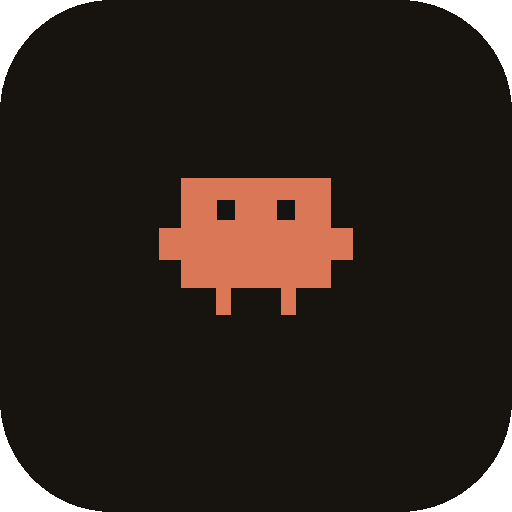
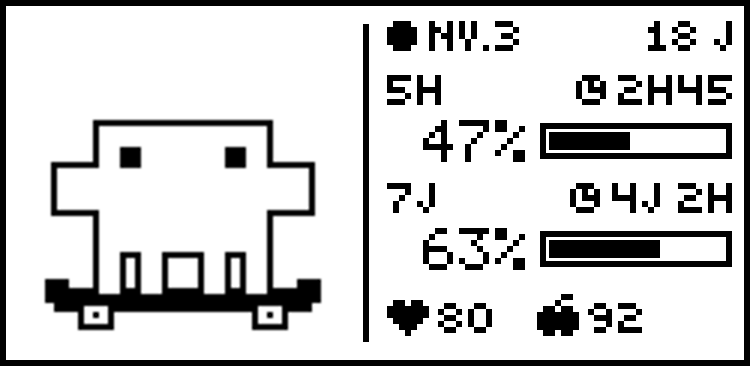
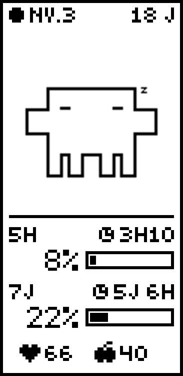
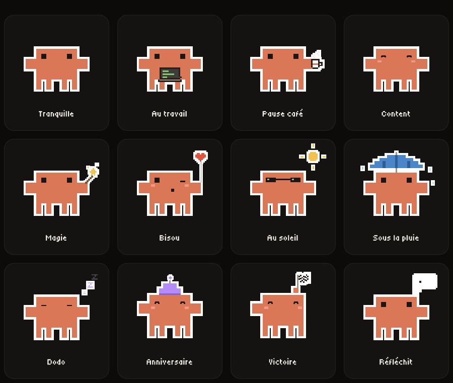

<div align="center">



# Claude e-paper

**Les limites de ton compte Claude Code, affichées par _Clawd_ la mascotte — sur ton navigateur et sur un écran e-paper de Raspberry Pi.**


<br/>

<em>Le rendu sur écran e-paper 2.13" — horizontal ou vertical :</em>




</div>

---

## 🐾 C'est quoi ?

**Claude e-paper** récupère l'état de ton forfait **Claude Code** (fenêtres de limite 5 h et 7 j) et l'affiche de deux façons :

- un **dashboard web** (protégé par passkey) ;
- une **image e-paper** poussée sur un écran e-ink de Raspberry Pi.

Le tout est incarné par **Clawd**, la mascotte crabe de Claude Code, qui change d'humeur et d'activité selon l'heure, ton activité et même ton anniversaire. C'est un mélange de tableau de bord et de **Tamagotchi**.

## ✨ Fonctionnalités

- 📊 **Vraies limites** — interroge le même endpoint que la commande `/usage` de Claude Code (fenêtres 5 h & 7 j, heures de reset).
- 🦀 **Clawd, la mascotte** — une douzaine de poses (au travail, pause café le matin, dodo la nuit, anniversaire, bisou, au soleil, sous la pluie…), qui **tournent au fil de la journée**.
- 🎮 **Stats Tamagotchi** — Énergie, Forme, Repu, Bonheur + un **niveau** qui monte avec le temps *et* avec ton usage.
- 🖥️ **Rendu e-paper fidèle** — génère le PNG exact de la dalle (N&B, sans anti-aliasing) ; l'aperçu web montre pixel pour pixel ce que reçoit la dalle.
- 🎞️ **Clawd vivant** — le Clawd officiel de Claude Code en pixel art (quatre pattes, contour sticker), animé **en continu** (respire, cligne, jette des regards, sautille, tremble quand ça chauffe…) : 1 image/s sur la dalle, fluide sur le web (yeux qui suivent ta souris) ; le point « online » clignote en direct.
- 🎨 **Générateur d'humeurs** — dans la galerie, compose une humeur (yeux, bouche, accessoire, chapeau, animation) : son sprite e-paper animé est généré, et le web le dessine en direct. Une nouvelle humeur a d'office une tête tirée de son nom (idée empruntée à [blobatar](https://github.com/Alain00/blobatar)).
- 🔐 **Auth passkey** — dashboard protégé par WebAuthn + code de récupération.
- ⚙️ **Installation en une commande** — `make install` (Node, libs, build) puis `make run`, ou en service `systemd` au boot.

## 🦀 Clawd & ses humeurs

<div align="center"></div>

Clawd ne se contente pas d'afficher un pourcentage : il **vit**. Sa pose est
choisie automatiquement selon le contexte :

- 🔄 **Rotation** — il change d'humeur au fil de la journée (intervalle réglable).
  Six humeurs sont fournies d'office, ce que fait Claude, d'après les visuels
  officiels : 💭 **Réfléchit** (bulle de pensée, yeux levés), 🔍 **Recherche**
  (en détective : chapeau, œil plissé, loupe qui grossit l'autre œil),
  💻 **Travaille** (tourné de 3/4, il tape sur son ordinateur posé au sol),
  💬 **Parle** (bulle qui s'écrit, bouche qui bouge), 🏁 **Terminé** (drapeau à
  damier) et ☕ **Pause café**. Ajoute les tiennes dans la galerie ; celles par
  défaut se renomment, se modifient, se suppriment… et se remettent.
- 😰 **Stress** — sous pression → stressé → cramé, selon la jauge la plus remplie.
- 😴 **Dodo** — la nuit, ou après un moment sans activité.
- 🎂 **Anniversaire** — la pose spéciale le jour J (date en config).
- 🎲 **Bouton shuffle** — force une humeur au hasard depuis le dashboard.

La pose est calculée **côté serveur** : l'écran web et l'e-paper affichent donc
toujours exactement la même mascotte (en couleur sur le web, en line-art N&B sur l'e-ink).

## 📐 Deux orientations

La dalle 2.13" (250×122) se monte dans le sens que tu veux (`epaperLayout` en config) :

**Horizontal (250×122)** : le carré mascotte à gauche (pleine hauteur), les infos à droite.

**Vertical (122×250)** : online en haut, le carré mascotte, puis limites et stats.

Dans les deux cas la mascotte occupe le même carré de 118×118 pixels : les
sprites sont dessinés à cette taille et affichés **1:1** (aucune perte).

## 🧩 Comment ça marche

La page `/usage` de Claude appelle un endpoint OAuth ; l'app fait la même chose :

```http
GET https://api.anthropic.com/api/oauth/usage
Authorization: Bearer <access_token>
anthropic-beta: oauth-2025-04-20
```

L'app a besoin d'un accès OAuth à ton compte Claude. Deux façons de le lui donner :

1. **Connexion depuis le dashboard** (recommandé) : **Config → Connexion à
   Claude → Se connecter à Claude**. Tu autorises l'accès sur claude.ai, tu
   recolles le code affiché, et l'app obtient **ses propres identifiants**,
   qu'elle rafraîchit seule. Claude Code n'a pas besoin d'être installé sur la
   machine, et tes autres machines restent connectées.
2. **Import des credentials de Claude Code** (section « Avancé ») : copie de
   `~/.claude/.credentials.json` ou du trousseau macOS, rafraîchie
   automatiquement. ⚠ Ces identifiants sont alors partagés : quand une machine
   les rafraîchit, l'autre est déconnectée.

> [!NOTE]
> Un token `claude setup-token` ne suffit pas : il ne donne que le droit
> d'utiliser Claude (`user:inference`), alors que l'endpoint des limites exige
> `user:profile` (réponse 403).

Les identifiants vivent dans `CONFIG_DIR/credentials.json` (permissions 600) et
ne sont jamais renvoyés par l'API ni écrits dans les logs. L'app met en cache le
résultat et le diffuse en temps réel (SSE) au dashboard et au moteur de rendu.

> [!WARNING]
> Cet endpoint **n'est pas une API publique documentée**. Réutiliser le client OAuth public de Claude Code (connexion depuis le dashboard) ou ses tokens dans un outil tiers se situe en zone grise vis-à-vis des CGU d'Anthropic. Projet **personnel**, à utiliser à tes risques.

## 🛠️ Matériel

Cible de référence de ce projet :

- **Raspberry Pi Zero 2 W** (OS 64-bit) — quad-core ARMv8.
- **Waveshare 2.13-inch e-Paper HAT** branché sur les broches GPIO (SPI).

## 🚀 Installation (Raspberry Pi, sans Docker)

Tout passe par un **Makefile idempotent** : chaque cible vérifie et n'installe /
ne rebuild que ce qui manque.

```bash
sudo raspi-config       # Interface → SPI → activer (une fois)
git clone https://github.com/Vincweb/claude-epaper.git && cd claude-epaper
make install            # apt (libs e-paper), Node 22, lib Waveshare, npm install, build
make run                # app :8787 + boucle e-paper si la dalle est branchée (Ctrl-C stoppe tout)
```

| Cible | Rôle |
|---|---|
| `make install` | installe **ce qui manque** : paquets apt, Node 22 (NodeSource), lib Waveshare (`~/e-Paper`), `npm install`, build |
| `make run` | lance l'app ; si `/dev/spidev0.0` existe, lance aussi la boucle e-paper |
| `make services` | installe + active les unités `systemd` (user & chemins auto-détectés) → **démarre au boot** |
| `make update` | `git pull` + réinstalle/rebuild ce qui a changé + **re-synchronise les unités systemd** si elles sont installées (chemins/env à jour) — aussi accessible depuis le dashboard (**Config → Système → Mettre à jour l'app**) |
| `make dev` | hot-reload serveur + web (développement) |

**Première connexion :** le dashboard te demande de créer une **passkey**
(Touch ID / Face ID / clé de sécurité) et affiche un **code de récupération** (en
QR) à sauvegarder. Ensuite, branche tes limites dans **Config → Connexion à
Claude** : **Se connecter à Claude** ouvre la page d'autorisation de Claude ;
recolle le code affiché puis **Valider et tester**. Le dashboard répond
« Connecté : 5 h xx %, 7 j xx % » ou l'erreur exacte. L'ancien import des
credentials Claude Code reste disponible dans la section **Avancé**.

**Au boot :**

```bash
make services
journalctl -u claude-epaper -f     # logs de l'app
journalctl -u epaper-push -f       # logs de la dalle (refresh partiel/complet)
```

> Zero 2 W à court de RAM au build ? Builde sur ta machine (`npm run build`), copie
> `server/dist/` + `web/dist/` + `server/fonts/` sur le Pi, puis
> `npm install --omit=dev -w server` (express + resvg, binaires ARM précompilés).

## 🖥️ Brancher l'e-paper

La boucle [`epaper_push.py`](scripts/epaper_push.py) tire `/api/render.png` chaque
seconde (pour suivre les animations) mais **ne touche la dalle que si l'image a
changé**. À la façon de [Bjorn](https://github.com/infinition/Bjorn) :

- **refresh partiel** à chaque changement (rapide, sans clignotement) ;
- **refresh complet périodique** (tous les `FULL_REFRESH_EVERY` partiels ou toutes les `FULL_REFRESH_SECONDS`) pour effacer le ghosting.

Réglages (variables d'environnement, dans [`epaper-push.service`](scripts/epaper-push.service)) :

| Variable | Défaut | Rôle |
|---|---|---|
| `EPD_MODEL` | `epd2in13_V4` | module `waveshare_epd` de ta dalle |
| `POLL_SECONDS` | `1` | intervalle de tirage — anime à 1 image/s (n'écrit que si l'image a changé) |
| `FULL_REFRESH_EVERY` | `1800` | refresh complet tous les N partiels (garde-fou) |
| `FULL_REFRESH_SECONDS` | `1800` | refresh complet au moins toutes les X s (anti-ghosting) |
| `EPAPER_THRESHOLD` | `160` | seuil de binarisation 0-255 (sous le seuil → noir) |
| `REQUEST_TIMEOUT` | `20` | timeout (s) du fetch du PNG |
| `RENDER_URL` | `http://localhost:8787/api/render.png` | URL du PNG |
| `RENDER_API_KEY` | — | clé d'API (Config → Application iOS), seulement si le serveur n'est **pas** sur le Pi |
| `LOG_EVERY_SECONDS` | `3600` | bilan d'activité dans le journal (plus de ligne par seconde) |

La boucle encaisse les erreurs de la dalle (réinitialisation sans planter) et
met la dalle en **veille** quand le service s'arrête.

**Repos quand Clawd dort** (page e-paper, activé par défaut) : la nuit ou après
une période d'inactivité, l'image n'avance plus qu'une fois par minute au lieu
d'une fois par seconde — beaucoup moins d'usure, et pas de flash de refresh
complet en pleine nuit (un refresh complet est fait au réveil).

> Le rendu est généré **sans anti-aliasing** : l'onglet **e-paper** du dashboard
> montre exactement ce que reçoit la dalle. Dalle montée à l'envers ? Coche
> **Rotation 180°** sur la page **e-paper** (l'aperçu web, lui, reste à l'endroit).

> ⚠️ La **mise à jour depuis le dashboard** (`self-update.sh`) fait `git pull` +
> build + redémarre les process, mais **ne réinstalle pas les unités systemd**
> (ça demande `sudo`). Si un `*.service` change (ex. variables d'environnement),
> relance **une fois** `make services`. Les réglages de comportement de la boucle
> (`POLL_SECONDS`, `FULL_REFRESH_*`…) ne sont plus figés dans l'unité : ils
> suivent les défauts du script, donc une simple mise à jour du code les fait
> évoluer.

## 💻 Développement

```bash
npm install
npm run dev      # web (Vite :5321) + API (:8787), hot-reload
```

Sur macOS, `make install` saute les étapes matérielles (apt, Waveshare).

## 🔐 Sécurité

Le dashboard est protégé par une **passkey WebAuthn**. Si tu perds ta passkey,
connecte-toi avec le **code de récupération**. Les passkeys exigent un accès
**HTTPS** (ton domaine) ou `localhost` ; sur une IP LAN en HTTP, utilise le code
de récupération. L'auth (credential + code haché) vit dans `CONFIG_DIR/auth.json` :
un accès direct à la machine permet de la réinitialiser en supprimant ce fichier.
Seule l'image de la dalle (`/api/render.png`) est servie sans authentification
à la **boucle locale** (le script e-paper sur le Pi) — et seulement en accès
direct : une requête relayée par un reverse proxy installé sur le Pi doit
s'authentifier comme les autres. Si `auth.json` devient illisible, l'accès est
verrouillé (supprime-le pour réinitialiser). Le code de récupération est limité
à 5 essais par minute.

## 📁 Structure

```
server/   API Node/TS : credentials + auth passkey + fetch usage + SSE + rendu PNG (resvg)
web/      Dashboard React/TS + Tailwind (react-router : Écran, e-paper, Humeurs, Config)
docs/     Visuels du README
scripts/  epaper_push.py (boucle e-paper) · gen-assets.mjs (visuels)
          claude-epaper.service · epaper-push.service (systemd) · self-update.sh
Makefile  install / run / update / services / dev
```

## 🗺️ Roadmap

Ce qui est prévu / en réflexion : **[ROADMAP.md](ROADMAP.md)**.

## 🙏 Crédits & mentions

- **Clawd** est la mascotte de Claude Code (Anthropic). Ce projet en propose une reconstruction pixel-art open source.
- Refresh e-paper inspiré du projet [Bjorn](https://github.com/infinition/Bjorn).
- Projet personnel, non affilié à Anthropic.

## 📄 Licence

[MIT](LICENSE).
